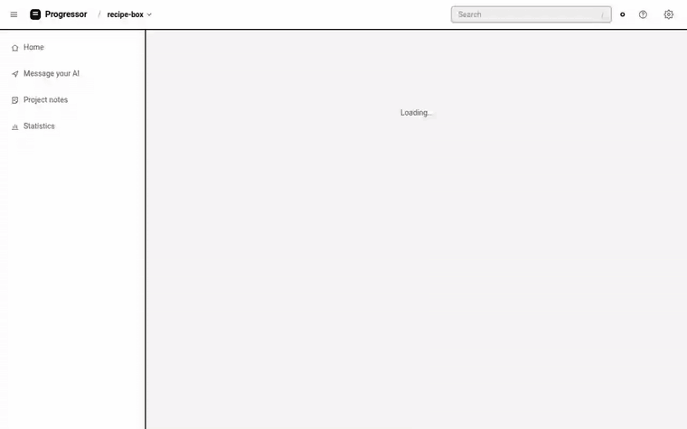

# Progressor

[](https://www.npmjs.com/package/progressor-mcp) [](https://github.com/racstan/progressor-mcp/actions/workflows/test.yml) [](LICENSE)



<sub>The dashboard follows an Agent through a Goal: Tasks tick off, a Detour is merged back, another one recalibrates the plan, and a stop is opened to copy it as a prompt. [Watch as video](docs/media/demo.mp4).</sub>

Progressor keeps an AI coding Agent and you, the Developer, focused on the same Goal across long sessions, context compression and distractions. It is an [MCP](https://modelcontextprotocol.io) server: your Agent's app starts it, and the Agent uses its tools to keep a live record of what is planned, what is done, and what came up along the way.

The record is plain markdown inside your project, in `.progressor/`, so it is readable, diffable and travels with the repo. See [GLOSSARY.md](GLOSSARY.md) for the words used here and [docs/markdown-format.md](docs/markdown-format.md) for the file format.

## Install

With Claude Code, install Progressor once and set your project up from its folder:

```bash
npm install -g progressor-mcp
progressor-mcp init
```

`init` lists what it will change and asks once before doing it (`--yes` skips the question):

- `.mcp.json`: registers the `progressor` MCP server for the project.
- `.claude/settings.json`: adds the two [Claude Code hooks](#claude-code-hooks-recommended).
- `CLAUDE.md`: adds a short note telling the Agent to use Progressor.
- `.progressor/roadmap.md`: an empty Roadmap.

Running it again changes nothing; `progressor-mcp init --remove` takes the first three out again and leaves your `.progressor/` record alone. Restart Claude Code in the folder afterwards.

To only add the server, without the hooks or the note:

```bash
claude mcp add progressor -- npx -y progressor-mcp
```

Any other MCP client can run the same command over stdio: `npx -y progressor-mcp`. Progressor needs Node 22 or later. It keeps its files in the folder the client starts it in; set `PROGRESSOR_ROOT` to use another folder.

### Claude Code hooks (recommended)

An Agent can forget to call `get_status`, especially after its context has been compressed. With Claude Code you can take that out of its hands: two hooks put the plan in front of the Agent automatically.

- **At session start, on resume and after compaction**, the Agent gets the full status: the Goal, the current Task and its summary, any open Detour, the next Task and your Standing Instructions.
- **On every message**, it gets one line, such as `[Progressor] Goal: Ship OAuth login · Task: t2 Fix callback redirect loop · Next: t3 End-to-end tests`. The line is left out when no Goal is being worked on.

`progressor-mcp init` sets them up for you. To add them by hand, install Progressor globally (`npm install -g progressor-mcp`), then add this to `.claude/settings.json` in your project (or to `~/.claude/settings.json` for every project). If the file already has a `hooks` section, add these two entries to it:

```json
{
  "hooks": {
    "SessionStart": [{ "hooks": [{ "type": "command", "command": "progressor-mcp hook session-start" }] }],
    "UserPromptSubmit": [{ "hooks": [{ "type": "command", "command": "progressor-mcp hook prompt" }] }]
  }
}
```

The hook reads `.progressor/` straight from disk, so it needs no running server, and it prints nothing in projects that don't use Progressor. It never blocks or fails a message: if anything goes wrong, it stays silent. Without a global install, `npx -y progressor-mcp hook ...` works as the command too, but npx adds about 1.5 seconds to every message while it checks the package, so a global install is recommended.

## How it works

1. **Goals** live on the Roadmap, `.progressor/roadmap.md`. Each Goal has a **Plan File**, `.progressor/goals/<goal>.md`, with its **Tasks**. Every Task has a short title, the files it touches and a one-to-two-line summary of the fix or change it makes.
2. Each Agent conversation is a **Session**. A Session **claims** one Goal, so two conversations never work on the same Goal at once. When the conversation ends, the Claim is released and the Goal is paused until a Session claims it again.
3. At the start of a conversation, and after its context has been compressed, the Agent calls `get_status` to see the Goal, the current Task, any open Detour, the next Task and your Standing Instructions. With the [Claude Code hooks](#claude-code-hooks-recommended), it is handed this status automatically.
4. When the Agent has to do something that is not the current Task, it declares a **Detour** with a Reason instead of drifting silently. It ends the Detour in one of three ways:
   - **Merge back**: a small fix, done; the plan is unchanged.
   - **Return**: back to the plan, optionally adding the Detour's intended work as new Tasks at the end.
   - **Recalibration**: the remaining Tasks are dropped and replaced by a new Task list.
5. Features that come up but are not needed now are parked as **Ideas**, and can later be **promoted** to a Task or a Goal.
6. Lasting rules you give the Agent ("ask me before recalibrating") are saved as **Standing Instructions** and shown in every `get_status`, so they survive context compression and new conversations.

You steer by talking to the Agent; it is the only writer of the `.progressor/` files. You can still edit them by hand: Progressor keeps everything it does not recognise and only rewrites the lines it changes.

A Goal can have an **Outcome**, one line saying what done looks like ("users can sign in with Google and stay signed in"), and a short ID of your choosing (`oauth`) instead of one made from its title. The Outcome is shown with the status and on the dashboard. Adding a Goal with the same title as an existing one is refused unless the Agent says it means it. Work that is already finished can be recorded in one call, as a done Goal with done Tasks, so the Roadmap shows it too.

Every item has a ref such as `progressor://ship-oauth-login/t2` that you can paste into the chat; the Agent looks it up with `get_item`.

## The dashboard

While your Agent's app is running Progressor, open **http://localhost:4747/** in a browser. It is one dashboard for every project you use Progressor in: pick the project in the sidebar. Each `get_status` ends with a `Dashboard:` line that links straight to that conversation's project (`http://localhost:4747/?project=<id>`), so the Agent can hand it to you; the server prints it to its log too. It is served by the same process as the MCP tools, so there is nothing else to install or start.

The dashboard shows the selected Goal in one of three views, picked in the top bar (⇢ Across, ⇣ Down, ☰ List). The view is remembered by your browser and kept in the address (`&view=vertical`, `&view=checklist`), so a link shows the same thing:

- **Metro, horizontal** (the default): a metro map running left to right.
- **Metro, vertical**: the same map running top to bottom, so a long plan scrolls down. The mouse wheel scrolls it; Ctrl + wheel (or a pinch) zooms.
- **Checklist**: the Tasks as a list in plan order, each with its files and summary, and each Detour indented under the Task it branched from with how it ended and its Reason.

On the maps, Tasks are stops on a line with their files as small chips, Detours are orange branches labelled with how they ended (Merge back, Returned, Recalibrated or open), and Tasks dropped by a Recalibration stay on the old line, faded. A banner shows what is happening now: the current Task, or the open Detour and where it branched from. The sidebar has the project switcher (each project's name and folder) and the Roadmap with each Goal's progress, under the full path of the project folder it comes from. Your Standing Instructions and the parked Ideas are in the **❓ Help** menu in the top bar. Only one project is shown at a time, and the page updates by itself as its markdown changes.

- **Zoom** with the mouse wheel or the + / − buttons, **pan** by dragging the background, and **fit** the whole map with ⤢. Stops can be dragged; they spring back when you let go.
- Click any Task, Detour, Idea or Standing Instruction for its details (a Task's summary, a Detour's Reason) and **Copy as prompt**: a self-describing text (what it is, its status, its `progressor://` ref, file and line, its Goal, its summary, where it branched from, its Reason, its neighbours and the files it touches) to paste into your Agent chat.
- **Open in file** opens the Plan File at the item's line, or the code a Task touches, in your editor.
- The **Detours** switch hides the Detours from the view only; `[` collapses the sidebar. The sun / moon button switches between light and dark.
- When a Goal is finished it turns green and gets a green dot in the sidebar until you open it; then it moves to the **Done** group at the bottom. Right-click a Goal to hide it from the list, or to move a finished one to Done without opening it.
- **⚙️ Settings** sets the view a Goal opens in (Across, Down or List), the theme (light, dark or match the system), the editor for "Open in file", whether finished Goals wait for you or go to Done straight away, and whether hidden Goals are shown. Settings are saved in that browser.

The dashboard is view-only: you change the plan by talking to the Agent. Hiding a Goal or moving it to Done changes only what your browser shows. To add work to a finished Goal, ask the Agent: claiming the Goal again reopens it, and the new Tasks join the same list.

### Choosing the editor

"Open in file" uses VS Code by default. Pick another editor under **Open files in** in the dashboard's ⚙️ Settings (remembered in that browser), or set it for the project with `PROGRESSOR_EDITOR` in the MCP server's environment:

```bash
claude mcp add progressor -e PROGRESSOR_EDITOR=cursor -- npx -y progressor-mcp
```

| `PROGRESSOR_EDITOR`                                                                 | Opens                                     |
| ----------------------------------------------------------------------------------- | ----------------------------------------- |
| `vscode` (default), `vscode-insiders`, `vscodium`, `cursor`, `windsurf`, `zed`       | the file at the line, by its full path     |
| `idea` (or `jetbrains`), `webstorm`, `pycharm`, `phpstorm`, `goland`, `rider`, `rubymine`, `clion`, `rustrover` | the file in the open project, through [JetBrains Toolbox](https://www.jetbrains.com/toolbox-app/) |
| a URL template, such as `myeditor://open?file={path}&line={line}`                   | anything else: `{path}` is the full path, `{relPath}` the path inside the project, `{project}` the folder name and `{line}` the line |

### One dashboard for every project

Every Progressor server adds its project folder to a per-user list, `~/.progressor/projects.json` (`PROGRESSOR_REGISTRY` points it elsewhere). Whichever Progressor process holds the port serves every project on that list, reading each project's `.progressor/` files straight from disk; the others link to it. If that process ends, the next Progressor server to start, or the next `get_status` from one already running, takes over. Projects whose folder or `.progressor/` has gone are not shown. To take a project off the list, delete its entry from the file.

The dashboard listens on the loopback address only (`127.0.0.1`, and `::1` where there is IPv6), port 4747 by default (`PROGRESSOR_PORT` changes it). A port held by another program is skipped for the next free one. Set `PROGRESSOR_DASHBOARD=off` to run without the dashboard.

### Workspaces: every project in a folder

If your projects live under one folder, open the dashboard on it from anywhere, with no Agent running:

```bash
progressor-mcp dashboard C:\Programming
```

Progressor looks through that folder and its subfolders for projects: folders with a `.progressor/roadmap.md`. It skips `node_modules`, `.git`, build output and other hidden or dependency folders, and goes 5 levels deep. Nothing is created or changed; a folder only becomes a project once an Agent adds a Goal in it. The dashboard opens in your browser on an overview of that Workspace, with each project's Goals in progress, how far along they are, and a green note when a Goal has finished since you last looked. Click a project or a Goal to open it.

The folder is remembered as a Workspace in `~/.progressor/workspaces.json`, so the dashboard keeps showing its projects, grouped under it in the project switcher, even when it is started by an Agent later. New projects in a Workspace show up within a few minutes, or straight away when you run the command again. `progressor-mcp dashboard --forget <folder>` stops showing a Workspace; `--no-open` prints the address without opening the browser. Without a folder, the command uses the current one.

When the dashboard shows more than one project, its start page is the overview of them all (**🗂 All projects** in the switcher).

### Slash commands

In Claude Code, Progressor adds three commands to the `/` menu:

| Command                          | What it does                                                                                     |
| -------------------------------- | ------------------------------------------------------------------------------------------------ |
| `/mcp__progressor__status`       | A short summary of where things stand; with no Goal claimed, the Goals to pick from.             |
| `/mcp__progressor__plan <goal>`  | The Agent proposes a title, short ID, Outcome and Tasks for the Goal you describe, and waits for your OK before adding it. |
| `/mcp__progressor__review [goal]` | The Agent checks a Goal's finished Tasks against the code and its Outcome, and says what is missing. |

## Example

```markdown
# Ship OAuth login

## Tasks

- [x] Add the /login route ^t1
  - summary: Serve the login page and redirect to the provider with the client ID and state.
  - code: `src/routes/login.ts`
- [/] Fix callback redirect loop ^t2
  - summary: Callback re-sets the session cookie on every hit; only set it after token exchange.
  - code: `src/auth/callback.ts`
  - code: `src/auth/session.ts:42`
- [ ] Add logout ^t3

## Detour: Fix flaky token refresh ^d1

- branched from: ^t2
- reason: The callback tests fail randomly because token refresh races the cookie write
- status: open
```

## Tools

| Tool                       | What it does                                                                 |
| -------------------------- | ---------------------------------------------------------------------------- |
| `get_status`               | Summary of the claimed Goal, current Task, open Detour, next Task and Standing Instructions. |
| `get_item`                 | Looks up any item by ref, with its file and line.                            |
| `add_goal`                 | Adds a Goal to the Roadmap, with an optional Task list, Outcome and short ID; with `done`, records finished work. |
| `update_goal`              | Renames a Goal or changes its Outcome.                                       |
| `move_goal`                | Moves a Goal before or after another on the Roadmap.                         |
| `drop_goal`                | Drops a Goal that is no longer wanted, with a reason.                        |
| `claim_goal`               | Claims a Goal for this Session (pausing any other it held).                  |
| `release_goal`             | Releases the Claim; the Goal is paused.                                      |
| `complete_goal`            | Marks the claimed Goal done.                                                 |
| `add_tasks`                | Appends Tasks (title, files and summary) to the claimed Goal.                |
| `start_task`               | Marks a Task in progress (one at a time).                                    |
| `update_task`              | Changes a Task's title, summary or files.                                    |
| `complete_task`            | Marks a Task done, recording the files it touched and its final summary.     |
| `drop_task`                | Drops a Task with a reason.                                                  |
| `start_detour`             | Declares a Detour, with a Reason, branching from the current Task.           |
| `end_detour`               | Ends the open Detour: merge back, return or recalibrate.                     |
| `record_idea`              | Parks an Idea for later.                                                     |
| `promote_idea`             | Turns an Idea into a Task or a Goal.                                         |
| `add_standing_instruction` | Saves a lasting rule from the Developer.                                     |

## Development

```bash
npm install
```

```bash
npm test
```

```bash
npm run build
```

`npm run build` compiles the server to `dist/` and bundles the dashboard (React, in `src/ui/`) into `dist/ui/`; `node dist/cli.js` starts the server on stdio. To try the dashboard without an MCP client, serve it for one or more project folders (by default the sample in `test/fixtures/sample-project`). It runs on port 4800 with a throwaway project list, so it never takes the real dashboard's place:

```bash
node scripts/dashboard.mjs test/fixtures/sample-project
```

`npm run dev:ui` rebuilds the page on every change; reload the browser to see it. The server side of the dashboard is in `src/dashboard/`: the HTTP server and API (`http.ts`), the project list (`registry.ts`), the file watcher (`watch.ts`), and the pure logic shared with the page: the metro map layout (`graph.ts`), the Copy-as-prompt text (`prompt.ts`) and the editor links (`editor.ts`).

## Support

Progressor is free and open source. If it keeps you on track, you can [buy me a coffee](https://buymeacoffee.com/rachitasthana). The link is also in the dashboard's Help menu.

## License

Copyright (C) 2026 Rachit Asthana

Progressor is free software: you can redistribute it and/or modify it under the terms of the GNU General Public License as published by the Free Software Foundation, either version 3 of the License, or (at your option) any later version. It is distributed in the hope that it will be useful, but WITHOUT ANY WARRANTY; without even the implied warranty of MERCHANTABILITY or FITNESS FOR A PARTICULAR PURPOSE. See [LICENSE](LICENSE) for the full text.
