<h1 align="center">Progressor</h1>

1. **You lose track** of what's done, what's half-done and what's next, hopping between projects in your IDE and sessions in Claude Code or opencode.
2. **Your AI forgets the plan** the moment the chat's memory is compressed.
3. **Your AI says "done" when it isn't,** or quietly drifts off the plan.
4. **There's nowhere to see your whole project** at a glance, today or months from now.
5. **A customer bug lands mid-feature,** and the work you were doing gets lost in the scramble.

**Progressor fixes all of them, for free.** Your AI writes its plan into your project and keeps it up to date as it works, and you see every project on one beautiful page in your browser, instead of switching between projects in your IDE and sessions in Claude Code or opencode.

<p align="center">
  <a href="https://www.npmjs.com/package/progressor-mcp"></a>
  <a href="https://github.com/racstan/progressor-mcp/actions/workflows/test.yml"></a>
  <a href="LICENSE.md"></a>
</p>

<p align="center">
  <a href="https://youtu.be/PVk795l6om8">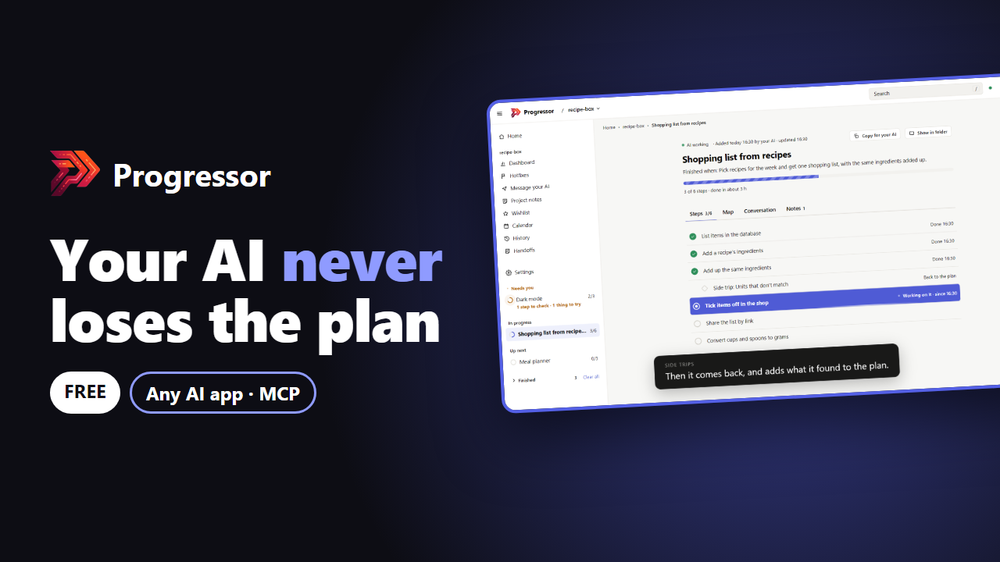</a>
  <br>
  <sub><a href="https://youtu.be/PVk795l6om8">▶ Watch the 4-minute video on YouTube</a></sub>
</p>

<p align="center">
  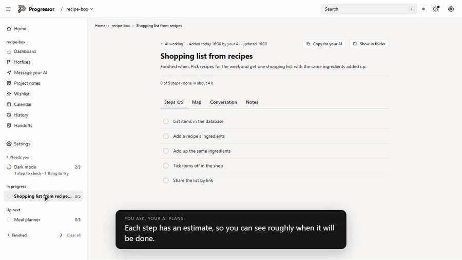
</p>

It works with any app that supports [MCP](https://modelcontextprotocol.io) (the standard way AI apps add tools): Claude Code, Claude Desktop, VS Code with Copilot, Cursor, Windsurf, Codex and others.

## Sound familiar?

### Your AI lost the thread

- **Vibe coding a project and can't keep track of what's going on anymore?**<br>
  Your AI writes its plan, a **goal** made of **steps**, into your project and ticks each step off as it works. You see it live on one page in your browser, instead of hopping between projects in your IDE and sessions in your AI app: what it's doing right now, what's done and what's left.
- **Your AI's memory got compressed, and your plan went with it?**<br>
  Almost every AI app compresses long chats, and an AI that forgets the plan writes sloppy code and leaves bugs behind. Progressor keeps the plan in your project, not in the chat: say *"use Progressor"* and your AI carries on from the exact step it was on. Claude Code does it by itself.
- **Switched from Claude Code to Cursor or Codex and lost everything?**<br>
  The plan belongs to the project, not the app. Whichever AI app opens the project next reads the same plan and picks up where the last one stopped.
- **Your AI wandered off the plan and didn't tell you?**<br>
  It can't drift quietly. Every **side trip** is recorded with its reason and drawn as a branch off the plan's map, so you see where the work left the route, and why.
- **Your AI says "done", but is it?**<br>
  Each finished step is linked to its commits and the test run behind it. Anything only a person can check, like how it feels on your phone, waits for you with **Works** and **Doesn't work** buttons.

### You're juggling too much

- **Working on several projects at once and drowning in the micromanagement?**<br>
  **Home** shows every project on one page: what needs you, what's being worked on and how far along it is, whichever AI app is doing the work.
- **Walked away and missed the moment your AI needed you?**<br>
  Questions, things to try and steps to check all wait in **Needs you**, and a free [ntfy](https://ntfy.sh) push can reach your phone the moment one arrives.
- **A customer bug lands in the middle of a feature?**<br>
  Paste it in as a **Hotfix** and it jumps the queue. Your AI finishes the step it's on, writes a test that shows the bug, then fixes it.
- **A big decision, and you want a say?**<br>
  Your AI lays out 2 to 4 **ways to go** as cards, with its pick marked. Choose one, or don't: it goes ahead with its pick, and you can still change course later.
- **Your AI changed the plan and you want the old one back?**<br>
  **History** keeps every change to the plan, by your AI or by you. **Go back to before this** undoes it, and the undo can be undone too.
- **The dashboard dies the moment you close the chat?**<br>
  Turn on the background dashboard and it stays up from the moment you log in, with no AI app open, in about 30 MB of memory.

### Your project is in it for the long run

- **Working on a project with long-term goals?**<br>
  Goals can wait on other goals, even in another project. Every step gets an estimate, every goal a rough finish, and the **Calendar** shows what comes next and when. The estimates learn from how long steps really took, so they get better as you go.
- **Release notes and weekly chores eating your evenings?**<br>
  Your AI writes the changelog and the next version number from the goals it finished, and asks you before publishing anything. Chores like a weekly dependency check become **goals that come back** by themselves.
- **Handing the project to someone else, or to yourself next week?**<br>
  Your AI writes a **handoff**, a plain write-up of what was done and what's next, after each release or whenever you ask.
- **Want a beautiful place to look up anything about your project?**<br>
  Every step as a list or a map, a Dashboard of the numbers, a Calendar, search across all your projects, and four themes, from calm black and white to colourful.

<p align="center">
  <a href="https://youtu.be/PVk795l6om8"></a>
  &nbsp;
  <a href="#set-it-up"></a>
</p>

## What you get

<table>
  <tr>
    <td width="50%" valign="top">
      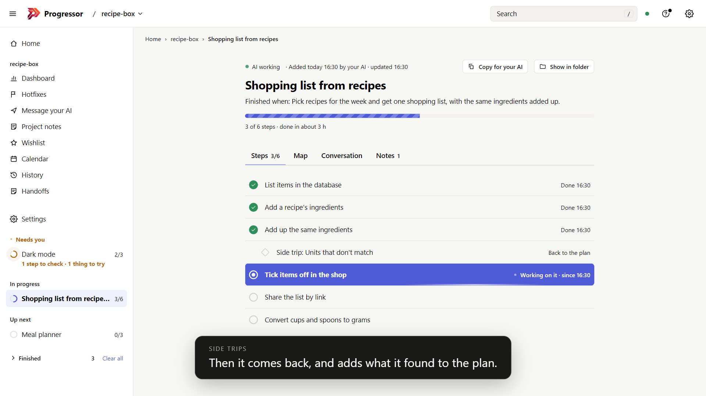
      <h3>Every step, live</h3>
      What the AI is working on is highlighted and moves; finished steps say when they were done. A <b>side trip</b> shows where the AI stepped off the plan, and why.
    </td>
    <td width="50%" valign="top">
      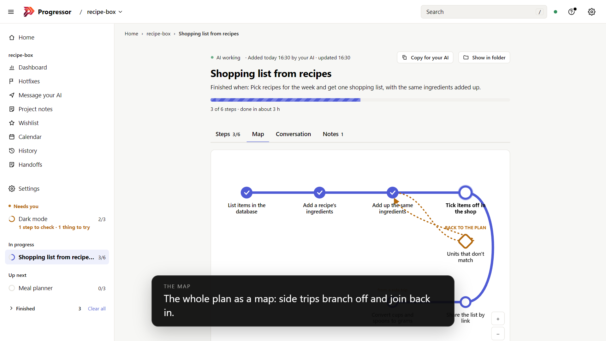
      <h3>The plan as a map</h3>
      Each step is a stop on a line. Side trips branch off and rejoin, and steps they add join the route, so you can see how the plan changed.
    </td>
  </tr>
  <tr>
    <td width="50%" valign="top">
      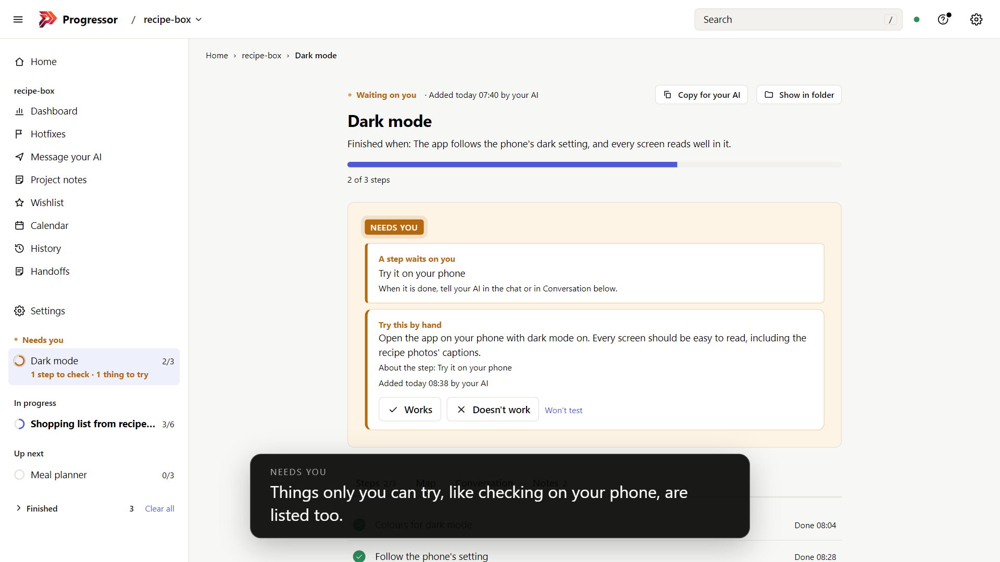
      <h3>It says when it needs you</h3>
      A question, a step to check, something to try on your phone: it all waits in <b>Needs you</b>, and you answer with a click. Your AI sees your answer at its next step.
    </td>
    <td width="50%" valign="top">
      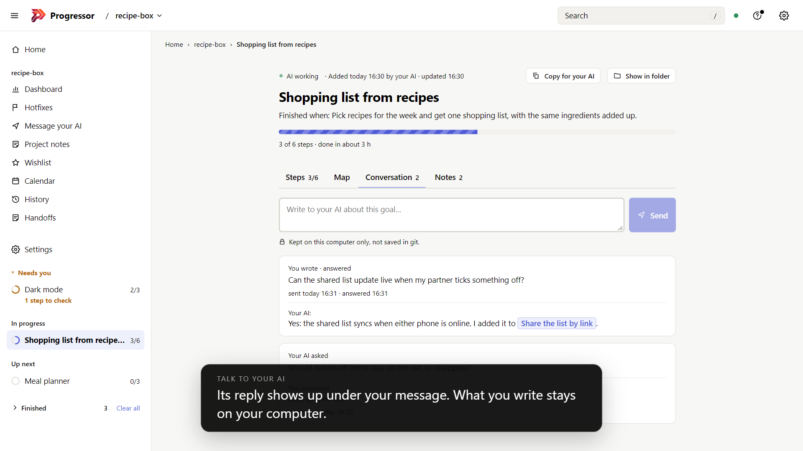
      <h3>Talk to your AI from the page</h3>
      Write to your AI about one goal or the whole project, and its replies show up under your messages. What you write stays on your computer, out of git.
    </td>
  </tr>
  <tr>
    <td width="50%" valign="top">
      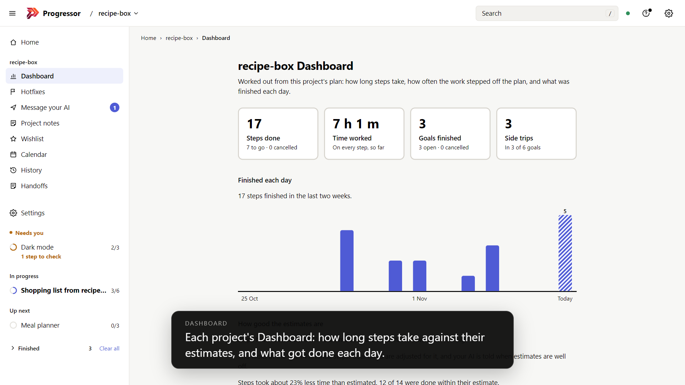
      <h3>A Dashboard of the numbers</h3>
      How long steps take against their estimates (and how the estimates are getting better), how often the work drifts, and what got done each day, for each project and for all of them on Home.
    </td>
    <td width="50%" valign="top">
      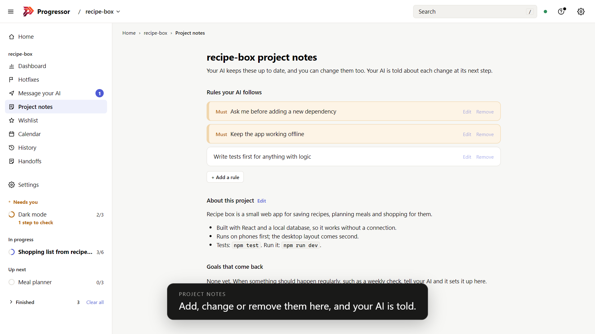
      <h3>Rules your AI keeps</h3>
      <i>"Always ask before adding a dependency."</i> Lasting rules and the project's background live in <b>Project notes</b>. Add, change or remove them there, and your AI is told.
    </td>
  </tr>
  <tr>
    <td width="50%" valign="top">
      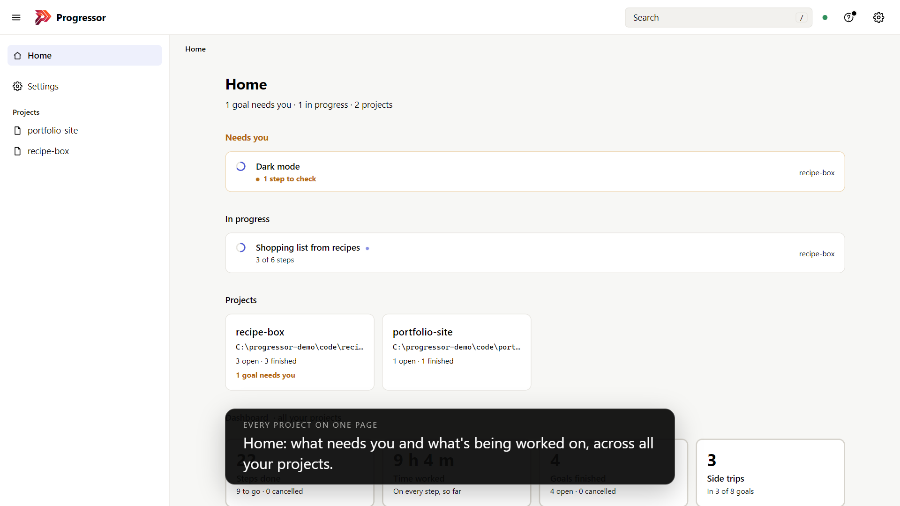
      <h3>Every project on one page</h3>
      <b>Home</b> shows what needs you and what's being worked on across all your projects, in any app, with the numbers for all of them.
    </td>
    <td width="50%" valign="top">
      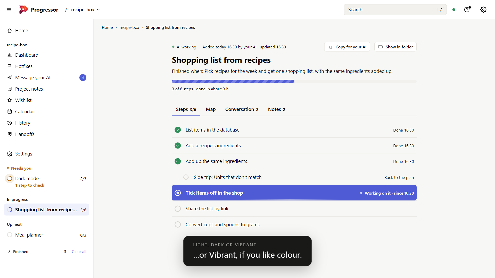
      <h3>Light, dark or colourful</h3>
      <b>Vibrant</b> by default, with black text, or a calm black-and-white look in light or dark. <a href="https://raw.githubusercontent.com/racstan/progressor-mcp/main/docs/media/dark.png">See dark</a>.
    </td>
  </tr>
  <tr>
    <td width="50%" valign="top">
      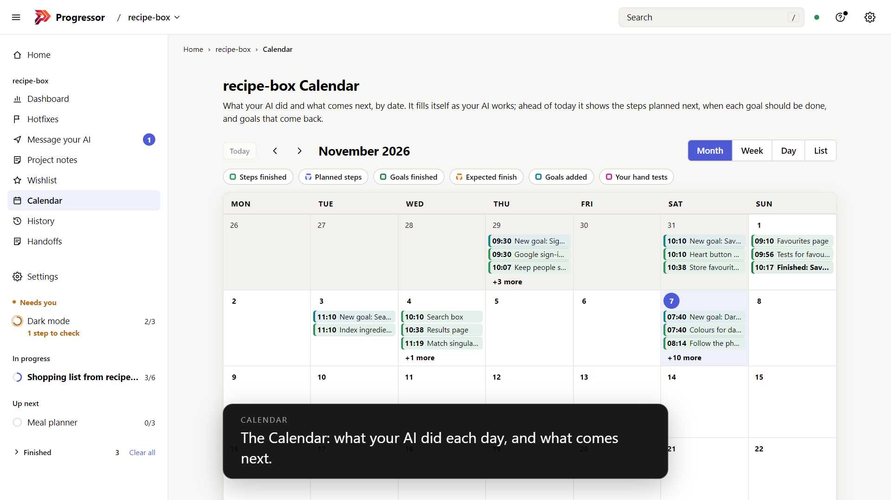
      <h3>A calendar of the work</h3>
      What your AI finished each day, releases and handoffs, and ahead of today, the steps planned next and when each goal should be done.
    </td>
    <td width="50%" valign="top">
      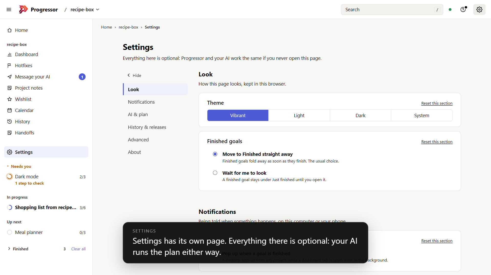
      <h3>Settings, all optional</h3>
      The look, pop-ups and phone notifications, and how your AI works, grouped on one page. Your AI runs the plan the same whether you ever open it or not.
    </td>
  </tr>
</table>

## Your progress is never lost

A compressed chat, a new chat or a different AI app never costs you your progress:

- **Everything is saved in your project.** The goals, every step and where each one stands, the side trips and why they happened, the decisions made along the way, notes, your rules and the project's background are kept in plain files in your project folder, not in the chat.
- **Private, and yours.** The plan is plain markdown files on your computer: nothing is sent anywhere, and it's kept out of git unless you ask your AI to share it ([how](docs/faq.md#is-my-plan-private-should-i-commit-the-progressor-folder)). You can read every file, and delete them whenever you like.
- **The same plan for you and the AI.** What you see on the dashboard is what the AI reads, so you always know what's done, what's under way and what's waiting on you.

## Set it up

You need [Node.js](https://nodejs.org) 22 or later. Then paste this into your AI's chat, in the project you're working on:

```text
Set up Progressor (https://github.com/racstan/progressor-mcp) for this project:
1. Run `node --version`. If it is older than 22, stop and tell me how to install Node.
2. Run `npm install -g progressor-mcp`.
3. If you are Claude Code or Claude Desktop, run `progressor-mcp init --yes` in this folder. Otherwise, add
   the "progressor" MCP server to this app's settings as the guide for this app shows
   (https://github.com/racstan/progressor-mcp/blob/main/docs/apps.md), then run
   `progressor-mcp init --yes --no-server` in this folder.
4. Tell me to restart the app, and to approve the "progressor" server if it asks.
   After the restart, call get_status and tell me in plain words that Progressor is
   ready, with the dashboard link.
```

Your AI does the rest. For Claude Code and Claude Desktop that one `init` command is the whole setup: it adds the server, the hooks that hand your AI the plan at the start of every conversation, and a short note telling the AI to use Progressor. To have Progressor in every project without setting each one up, add it once to your app's settings for all projects ([how, for each app](docs/apps.md)). If you'd rather do it yourself, [Getting started](docs/getting-started.md) walks through it, and [Setup for your app](docs/apps.md) has the exact settings for each app.

### Run it with Docker

Would you rather not install Node? Progressor also comes as a Docker image, `ghcr.io/racstan/progressor-mcp`, also on [Docker Hub](https://hub.docker.com/r/rachitasthana/progressor-mcp) as `rachitasthana/progressor-mcp`. You don't start the container yourself: your AI app starts one for each conversation, so you save the command it should use, once. Your project folder has to be mounted into the container, because that is where the plan is kept.

**1. Download the image** (optional; it also downloads the first time it's used):

```bash
docker pull ghcr.io/racstan/progressor-mcp
```

**2. Claude Code.** In your project's folder, on macOS or Linux:

```bash
claude mcp add progressor -- docker run -i --rm -v "$PWD:$PWD" -w "$PWD" -v progressor-data:/data -p 127.0.0.1:4800:4800 ghcr.io/racstan/progressor-mcp
```

On Windows, mount the folder under `/work` and say so: `-v "C:\Projects\shop:/work/shop" -w /work/shop -e PROGRESSOR_ROOT=/work/shop`.

**3. Claude Desktop, Cursor, Windsurf and other apps.** The same command goes in the app's MCP settings, with your project's folder in place of `/path/to/your/project`:

```json
{
  "mcpServers": {
    "progressor": {
      "command": "docker",
      "args": ["run", "-i", "--rm",
        "-v", "/path/to/your/project:/path/to/your/project", "-w", "/path/to/your/project",
        "-v", "progressor-data:/data", "-p", "127.0.0.1:4800:4800",
        "ghcr.io/racstan/progressor-mcp"]
    }
  }
}
```

VS Code calls the list `servers` instead of `mcpServers`, and Codex and others use their own format: [Setup for your app](docs/apps.md) shows where each one keeps it.

The dashboard is then at **http://localhost:4800**. The `progressor-data` volume keeps the project list and your settings between runs. Using Docker for two projects at once? Give the second its own port: `-p 127.0.0.1:4801:4801 -e PROGRESSOR_PORT=4801`.

**4. Dashboard only, always running.** To keep the dashboard up with no AI app open, run it as its own container that restarts by itself. Mount your projects' folder at the same path as in the commands above, so it can read their plans:

```bash
docker run -d --name progressor --restart unless-stopped -v progressor-data:/data -v "$HOME/projects:$HOME/projects" -p 127.0.0.1:4800:4800 ghcr.io/racstan/progressor-mcp daemon run
```

With this one running, leave `-p 127.0.0.1:4800:4800` out of the commands in steps 2 and 3. `docker stop progressor` stops it, and `docker rm progressor` removes it.

## Then just talk to your AI

Tell it what you want to build, as you would anyway: *"Add a login page with Google sign-in."* It plans the work as a goal, shows you the steps, and starts. You don't need to learn any commands. If you want to nudge it, these work in most apps' `/` menu:

| Command | What it does |
| --- | --- |
| `/progressor:next` | Carry on where the work was left |
| `/progressor:status` | Where things stand, in a few lines |
| `/progressor:plan` | Plan something new together |
| `/progressor:dashboard` | The dashboard's link |
| `/progressor:review` | Check a goal against what finished looks like, and add steps if something is missing |
| `/progressor:setup` | Set Progressor up in this project |

## On the dashboard

Open **http://localhost:4747** while your AI's app is open (your AI gives you the link). Everything on it is optional: your AI runs the plan by itself, and the page lets you watch and step in when you want to.

**Where it runs.** Usually the dashboard runs inside your AI's app and stops when the last one closes. If you'd like it up all the time, choose **Always, in the background** under Settings › Advanced, or run `progressor-mcp daemon install`: a small process starts when you log in and keeps the dashboard up with no AI app open (it uses about 30 MB of memory). Your AI's sessions share it, and `progressor-mcp daemon uninstall` puts things back. Both ways work the same; neither is needed.

**Finding your way**

- **Home** shows every project at once: what needs you, what's being worked on, and the numbers across all of them.
- **Rules for every project** on Home: rules and background your AI follows in all your projects, such as *"Never push without asking me"*. Add them there, or tell your AI *"in all my projects…"*.
- **Remove a project** from the dashboard: point at it in Home's sidebar and press **×**. Its files and plan stay as they are, and it comes back if your AI uses Progressor there again.
- **Breadcrumbs** at the top of every page say where you are, such as *Home › Bindery › Dashboard*; click Home or the project to go back.
- **Search** in the top bar (press `/`) finds projects, goals and steps across all your projects as you type.
- **Settings** has its own page, from the gear at the top or the sidebar, grouped into Look, Notifications, AI & plan, History & releases and Advanced, with a menu that folds away. Nothing there is required: Progressor works fully with the defaults.
- **A short tour** the first time you open the dashboard: a welcome that says Progressor is free (anyone selling it is not us), then the main parts of the page. Close it with Skip or ×, tick Don't show again, or take it again from ❓ Help or Settings › Look, where **Show the tour when the page opens** turns it on or off. If you're updating from an earlier Progressor, you get What's new instead.
- **Light, Dark, System or Vibrant.** Vibrant, the colourful one with black text, is the default; Light, Dark and System keep to black, white and greys.

**Each goal**

- **What the AI is doing:** *AI working*, *Waiting on you*, or *AI stopped* when its chat has closed, with how far along each goal is. What it's working on right now is highlighted and gently moves.
- **Every step, as a list or a map,** with side trips (where the AI stepped off the plan, and why), decisions and notes. Each says when it was added, by whom, and when it changed.
- **Commits and tests on each step:** a finished step shows the commits made for it and the test run behind it, linked when your project is on GitHub, GitLab or Gitea.
- **How long it will take:** your AI estimates each step and each goal shows a rough finish, *done in about 2 h*. The estimates learn: Progressor compares how long steps really took with the guesses and corrects the finish times.
- **Goals that wait on other goals** say *Waits on …*, even on a goal in another project, and their finish starts after that one's.
- **Needs you:** a question, a step to check or something to try by hand waits in one place, and you answer with a click. **Ways to go** shows 2 to 4 options as cards, with your AI's pick marked; if you don't choose, it goes ahead with its pick, and you can still change course later.
- **Talk to your AI** about one goal, or the whole project from **Message your AI**. Its replies show under your messages, and a number counts the ones you haven't read.
- **Pictures:** your AI can attach a screenshot or recording to a goal or step, so you see the change instead of reading about it.
- **Copy for your AI** and **Show in folder** on every goal and step.

**Each project's pages, in the sidebar** (under the project's name, Dashboard first; each page's heading names its project, such as *Bindery Dashboard*)

- **Hotfixes:** paste a bug report, such as one from a customer, and it goes to the top of your goals. Every AI chat in the project is told; the one that takes it finishes the step it is on, writes a test that shows the bug, then fixes it. You can also just tell your AI: *"Hotfix: checkout fails when the cart has a coupon."*
- **Project notes:** the rules your AI keeps and the project's background, which you can edit, and **Goals that come back**: goals your AI set to repeat, such as a weekly dependency check, which you can pause or stop.
- **Wishlist:** what you want from the project as a whole, in your own words, with files or pictures attached if you like. Your AI reads it and may suggest goals from it, but only you change it.
- **Dashboard:** the numbers worked out from the plan, with every goal in a list you can sort (newest, longest, most over its estimate…) (called Statistics before 1.3.0), with the **Plan check-up** card: what your AI's last look over the plan fixed, and **Check now**.
- **Calendar:** the project by month, week, day or as a list: what your AI finished, releases, hotfixes and handoffs, and ahead of today, the steps planned next and when each goal should be done.
- **History:** every change to the plan, by your AI or by you, with what it changed. **Go back to before this** undoes a change and everything after it, and going back can itself be undone.
- **Handoffs:** write-ups of a stretch of work for whoever picks it up next. Your AI writes one after each release, or when you ask for one between two dates.

**Staying in touch**

- **Phone notifications** through the free [ntfy](https://ntfy.sh) app: a push when your AI asks a question, has something for you to try, finishes a goal, offers ways to go, or a bug report comes in. Turn it on in Settings, then copy the private address Progressor made into the app with one click, or use your own ntfy server.
- **A desktop pop-up when a goal is finished,** from any of your projects, if you turn it on in Settings.
- **Never out of date:** if Progressor was updated, or the page lost touch with it, a bar says so with a **Refresh** button. **What's new** opens by itself the first time after Progressor is updated, with what changed (tick Don't show again to stop that), and is always in ❓ Help.

More in the [dashboard guide](docs/dashboard.md).

## What your AI does by itself

You never have to ask for these, and each one has a section in Settings if you want to change how it works:

- **Keeps the plan tidy.** At the start of each conversation it gives the plan a check-up, repairs what is safe to repair, and lists the rest.
- **Records the work.** Each finished step is linked to its commits, branch and test run, and your AI is warned when a step's files are not saved in git yet.
- **Learns from its estimates.** It sees how far off its guesses have been, so its next ones are better.
- **Writes the changelog.** When it's time for a new version, a release goal gathers the finished goals and commits since the last release, and your AI writes the changelog entry and the new version number from them. It asks you before tagging or publishing anything.
- **Brings routine work back.** A goal can come back every day, week, two weeks, month or on a weekday; a fresh one is added when it's due, never while the last one is still open.
- **Hands over.** It writes a handoff after each release, and whenever you ask.
- **Works across projects.** When a chat in one project does work for another, it records it in that project's plan, tagged *Updated from*.

More in [Using Progressor](docs/using.md#what-your-ai-does-by-itself).

## If something goes wrong

Most problems can be fixed by asking your AI. [Troubleshooting](docs/troubleshooting.md) lists the common ones, each with a line you can paste to your AI. Still stuck? [Report a problem](https://github.com/racstan/progressor-mcp/issues/new?template=bug_report.yml), or use **❓ Help** on the dashboard, which fills in your version and system for you.

## Docs

- [Getting started](docs/getting-started.md): setting up, step by step
- [Setup for your app](docs/apps.md): Claude Code, Claude Desktop, VS Code, Cursor, Windsurf, Codex and others
- [Using Progressor](docs/using.md): goals, steps, side trips, and what to say to your AI
- [The dashboard](docs/dashboard.md): everything on the page
- [Questions](docs/faq.md) and [Troubleshooting](docs/troubleshooting.md)
- [Updating and removing](docs/updating-and-removing.md)
- [Reference](docs/reference.md): commands, the AI's tools, settings and the file format, for the technically curious
- [Contributing](CONTRIBUTING.md): working on Progressor itself

## Feedback

What you run into shapes what comes next. [Share an idea or feedback](https://github.com/racstan/progressor-mcp/issues/new?template=idea.yml), even a sentence helps, or [see the open issues](https://github.com/racstan/progressor-mcp/issues).

<p align="center">
  <a href="https://mcprush.com/to/progressor-mcp?ref=badge"></a>
</p>

## Support

Progressor is free for personal and other noncommercial use. If it helps you, you can [buy me a coffee](https://buymeacoffee.com/rachitasthana); the link is also on the dashboard's Settings page, under About.

## License

Copyright (C) 2026 Rachit Asthana

Progressor is licensed under the [PolyForm Noncommercial License 1.0.0](LICENSE.md). You may use, change and share it for noncommercial purposes as that license defines them: personal use with no commercial application (study, research, hobby projects and the like) and use by charities, schools, public research bodies and government institutions. Any other use, including use by a business, needs a separate license from the author. See [LICENSE.md](LICENSE.md) for the full terms. Versions up to 1.2.2 were released under GPL-3.0-or-later, and copies of those versions keep that license.
